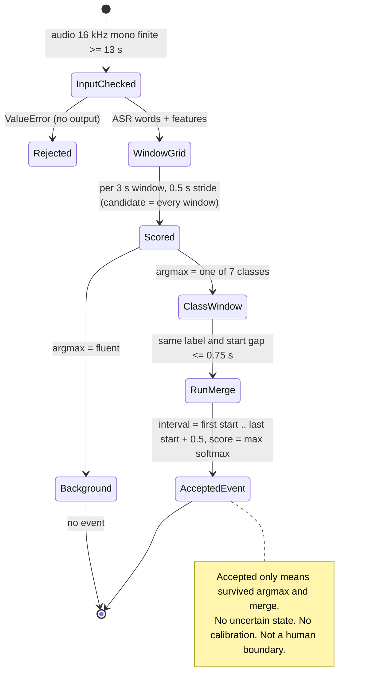
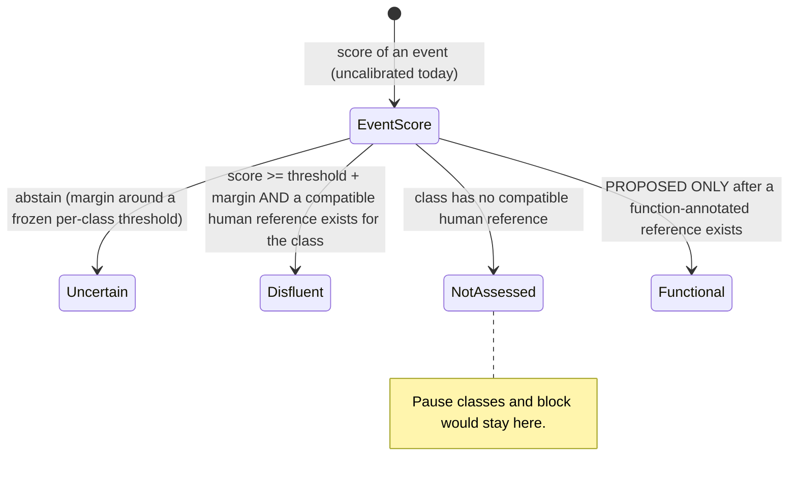

# Disambiguation criterion: what the engine decides, how, and what it does NOT decide (mrcd 0.3.0)

Status: formal description of the **implemented** criterion, with every rule traced to `file:line` and to existing tests. Anything the code does not do is labelled **PROPOSED, NOT IMPLEMENTED** and is never part of the current behaviour. No threshold in this document was invented; every number is quoted from the code or from an existing report.

Tags: `[IMPL]` implemented; `[PROPOSED]` not implemented; `[TRAIN]` exists only in the weak-label generator that produced the training labels, not at inference.

## 0. Summary

1. **There is no separate detector and no rule layer at inference.** Every window of the 0.5 s grid is a "candidate"; one network scores all of them and the argmax over 8 labels (`fluent` + 7 classes) is the decision. [IMPL]
2. **The output has no `functional` and no `uncertain` state.** The engine emits an event per run of same-class windows, with a raw score. A three-state rule exists only in `mrcd/decision.py` (`UNCERTAIN/PRESENT/ABSENT`), is used by research scripts, and is not called by `DisfluencyEngine`. [IMPL in decision.py; absent from the engine]
3. **Seconds are not converted into classes at inference.** `sil_dur` etc. are numeric network inputs. Seconds-based class rules exist only in the weak-label cascade [TRAIN], with thresholds the code itself labels "preliminary, subject to experimental calibration".
4. **Scores are not probabilities.** Nothing is calibrated.
5. **The reported interval is the decision stride, not a human boundary.**
6. Evidence for pause-class and `block` outputs is weak: no human reference exists for them (`INFORME_FINAL` (e)), and their emission depends on padding and duration (`pausas/PAUSAS.md`).

## 1. Vocabulary (fixed meanings)

| Term                   | Meaning in this specification                                                                                                                                                                                        |
| ---------------------- | -------------------------------------------------------------------------------------------------------------------------------------------------------------------------------------------------------------------- |
| Candidate              | A 3 s window on the 0.5 s grid that is scored. At inference **every** window is a candidate; there is no pre-filter. (In the [TRAIN] cascade, a candidate is a heuristic detection with a confidence 0.35-0.80.)     |
| Classificatory window  | The 3 s span `[t, t+3)` the network sees (plus up to 10 s of word context). It is the unit of decision.                                                                                                              |
| Accepted event         | A maximal run of consecutive windows with the same non-`fluent` argmax, fused by `_merge`. "Accepted" means only "survived argmax and merging"; it implies no validation.                                            |
| Human boundary         | The onset/offset a human annotator would mark. **Not produced by the engine.** The event interval is `[first window start, last window start + 0.5)`.                                                                |
| Score                  | The softmax output (`confidence`/`confianza`) or a Vc sigmoid score. Ranking quantity of an uncalibrated model.                                                                                                      |
| Calibrated probability | A score mapped to observed frequencies on held-out human-labelled data. **Does not exist for this engine** (`HEAD_CONTRACT.md` section 5).                                                                           |
| Three states           | `disfluent` / `functional` / `uncertain`. Not produced by the engine (see 5). Do not confuse with `decision.py`'s `present/absent/uncertain`, which refer to the _presence of one class in a unit_, not to function. |

## 2. Input variables (per window)

Defined in `HEAD_CONTRACT.md` section 3. Summary of what feeds the decision:

- acoustic frames: log-energy, speaker-centred F0 (semitones), voicing probability, VAD, dF0 (100 fps, 300 steps);
- prosody boundary vector (9): `sil_dur`, `sil_pos`, `f0_slope_pre`, `f0_range_pre`, `f0_level_pre`, `f0_reset`, `rms_slope_pre`, `final_lengthen`, `reset_valid`;
- words from the ASR within a 10 s context (5 s before the window start, 5 s after), up to 40 words, with 10 lexical/temporal features plus `zone` and `dangling`;
- **absent:** video/kinesic evidence (the `audio_text` checkpoint and `analyze()` reject it), speaker identity, semantic/syntactic parse, any human reference.

Quality of the inputs depends on the ASR (Whisper tends to delete repetitions and fillers; chunking trades that for false repetitions at seams) and on `OMP_NUM_THREADS` (`ASR_PROFILES_CONTRACT.md`).

## 3. Candidate generation and the weak-label cascade [TRAIN]

The checkpoint was trained on labels produced by `mrcd/annotation/auto_labeler.py` (label source `auto`, shipped `warning` = "PRUEBA DE HUMO"). Not used at inference, but it defines what the classes _mean_ to the network:

| Class                                                                                               | Heuristic that produced the training label (file:line)                                                                                                                                                                                                                                                      | Seconds-based?                                                 |
| --------------------------------------------------------------------------------------------------- | ----------------------------------------------------------------------------------------------------------------------------------------------------------------------------------------------------------------------------------------------------------------------------------------------------------- | -------------------------------------------------------------- |
| `block`                                                                                             | pause `>= silence_min_s = 0.60 s` inside a constituent (previous word is a function word, no clause punctuation) AND tense face (`mouth_press >= 0.40` or `brow_down >= 0.35`) -> confidence 0.80; same pause without face evidence -> 0.50; tense face and no boundary -> 0.60 (`auto_labeler.py:105-140`) | yes (0.60 s) and **requires video** that the engine never sees |
| `rhetorical_pause`                                                                                  | pause at a clause boundary with duration in `[0.80, 2.50]` s, tone falling or suspended (`abs(slope) <= 1 st/s`), relaxed face or no face -> confidence 0.55-0.80                                                                                                                                           | yes (0.80, 2.50)                                               |
| `neutral_pause`                                                                                     | any other silence `>= 0.60 s`                                                                                                                                                                                                                                                                               | yes (0.60)                                                     |
| `filler_word`, `prolongation` (>= 0.35 s, flat F0 <= 5 Hz), `repetition` (gap <= 1.5 s), `revision` | lexicon, duration, n-gram and edit-term rules (`auto_labeler.py:158-310`)                                                                                                                                                                                                                                   | partly                                                         |

Window label = the candidate with the largest `overlap x confidence` among candidates with confidence >= 0.5 and overlap >= min(0.30 s, half its duration) (`window_labels`, `auto_labeler.py:335-356`). The thresholds are `H` in `constants.py:63-75`, described as "preliminary design thresholds proposed by the author, subject to experimental calibration". **None has been calibrated.** The network can reproduce these rules, including their artefacts.

### Single pause value (2026-11-07)

There is ONE candidate-silence / neutral-pause value in this repository: `H["silence_min_s"] = 0.60 s` (`constants.py:64`), also used by the service to split ASR segments (`s3_features.GAP_S`). It is an **uncalibrated placeholder**: no human pause labels exist, so it has no measured justification. Older project notes that quote a 0.4 s pause figure refer to a different, never-implemented figure and must be read as 0.60 s. `tests/test_pause_constant.py` pins the constant.

## 4. Decision procedure at inference [IMPL]

```
analyze(audio, sample_rate, asr_chunk_s=8, keep_windows, terminal_window, span):
 1  reject unless mode in {audio_only, audio_text}                         engine.py:301
 2  reject unless 1-D, all finite, sample_rate == 16000, duration >= 13 s  engine.py:305-322
 3  words <- ASR(profile).transcribe_chunked(audio, 8 s, 2 s)              engine.py:324-328
 4  frames <- acoustic(audio); centre <- median voiced F0                  engine.py:526-527
 5  starts <- 0, 0.5, ... while s + 3 <= end                               engine.py:513-522
       (+ one window at end-3 if terminal_window and the grid misses it)   engine.py:523-524
 6  for each s: tensors(ac, pros, ling, lpos, lmask) -> z-norm -> net       engine.py:526-543
       p <- softmax over [fluent, filler, prolong, repet, block, revis, rhet_pause, neutral_pause]
       label_s <- argmax(p); confidence_s <- p[label_s]                    engine.py:548-549
 7  events <- merge(windows):                                              engine.py:607-661
       skip windows labelled fluent                                        :632
       extend a run while next.label == run.label and next.start - cur.start <= 0.75 s   :636-640
       start <- first.start; end <- last.start + 0.5
              (or the terminal window's start if one follows)             :645-648
       confidence <- max(confidence_s over the run)                        :654
       text <- text of the first window that has words                     :656
 8  if Vc loaded: scores <- sigmoid(head(pooled)); per class
       present <- max_over_windows(score) >= frozen threshold              engine.py:573-605, adaptation.py:280-293
       (events and windows are NOT modified; events of covered classes get a `validation` note)
 9  attach metadata, warning, ASR anomalies (reported, never filtered)     engine.py:336-358
10  return events, optional windows, optional head report
```

Order of decisions: input validation -> ASR -> features -> per-window argmax -> merge -> (optional) Vc report. No later stage can overrule an earlier one; Vc and V0 are never reconciled.

## 5. Output states

| Question                                                 | Current behaviour                                                                                                                                                                                                                                                                                                                                                                                                           |
| -------------------------------------------------------- | --------------------------------------------------------------------------------------------------------------------------------------------------------------------------------------------------------------------------------------------------------------------------------------------------------------------------------------------------------------------------------------------------------------------------- |
| Is there an output "disfluent / functional / uncertain"? | **No.** The engine emits class labels. `functional` does not exist as a concept in the engine (a "neutral" or "rhetorical" pause is a class name, not a functional verdict, and neither has a human reference).                                                                                                                                                                                                             |
| Where does `uncertain` exist?                            | `decision.three_state(score, threshold, margin=0.0)` returns `present` if `score >= threshold + margin`, `absent` if `score < threshold - margin`, else `uncertain`; a NaN score is always `uncertain` (`decision.py:102-114`). Used only by research scripts (`scripts/improve/properties_noref.py`); **not wired into the engine**. `windowing.should_abstain` (`windowing.py:91-93`) is opt-in and unused by the engine. |
| What does Vc emit?                                       | `present: bool` per class (`adaptation.py:288-290`), no `uncertain`. Note the inconsistency: `three_state` maps NaN to `uncertain`, `unit_decision` maps NaN to `present=False` (`nan >= thr` is false). Unreachable through `analyze` (needs at least 13 s, hence at least one window).                                                                                                                                    |
| Score                                                    | `confidence` = max over the run of the softmax max (raw, uncalibrated). Vc: sigmoid score, `calibrated: false`.                                                                                                                                                                                                                                                                                                             |
| Warnings                                                 | result-level `warning` (checkpoint provenance, experimental ASR profile, ASR anomalies); per-event `validation` only with Vc. No warning is generated for: ASR returned no words, trailing silence, padding artefacts, pause classes lacking references.                                                                                                                                                                    |
| Tie / equal scores                                       | `numpy.argmax` returns the first maximal index, i.e. the lowest label index, so `fluent` wins an exact tie. Practically measure-zero; no test pins it.                                                                                                                                                                                                                                                                      |
| Missing evidence                                         | No abstention. If the ASR returns no words, `linguistic_windows` returns zeros with an empty mask (`dataset.py:137`) and the network decides from acoustics alone; nothing flags it. If the audio has no silence, `pros` is all zeros. Absence of evidence is not represented.                                                                                                                                              |

## 6. Natural/functional pause versus block (explicit)

- At inference the engine **does not derive a class from a duration in seconds**. `sil_dur` is a continuous input; no `if sil_dur > x` exists in `mrcd/engine.py`, `inference.py` or `models/` (`tests/test_context.py::test_prosody_carries_no_heuristic_decision` checks that prosody field _names_ encode no class decision).
- The weak labels did use seconds (section 3). Whether the network's pause/`block` outputs track anything real is **unknown**: there is no human reference with pause onset/offset and function (DIHANA `p` has no duration or function; ESLORA pause tags have no audio/times; no annotated blocks) (`INFORME_FINAL` (e), `pausas/PAUSAS.md`).
- Measured sensitivity (existing report, 240 DIHANA turns, folds 1-3): appending 1.5 s of digital silence raised `rhetorical_pause` from 26/120 to 77/120 units (two longest bins) with identical speech; 62 % of `rhetorical_pause` windows on V0 contained padding; `block` emission grows with turn duration (2/60 -> 31/60) mostly independently of padding. Conclusion of that report: pause-class emission mixes speech and padding/trailing silence; it does not say any emission is right or wrong.
- Therefore, until a reference exists: do not report `rhetorical_pause`/`neutral_pause`/`block` as validated phenomena, do not turn them into "functional pause" or "blockage" claims, do not infer a class from a pause length, and do not average them as F1 = 0 (absence of reference is not zero).
- `block` was defined with facial tension in the weak labels; the audio-only engine cannot see the face. A `block` output therefore means "this window resembles windows the heuristic labelled block", mostly an intra-constituent pause plus duration effects.

## 7. Classificatory window versus human boundary

Events are made of windows 3 s wide that advance 0.5 s; each window is attributed to the stride it opens. The model used 3 s (and up to 10 s of words) to decide that stride. The reported interval is the **resolution** of the detection, not the extent of the evidence nor the phenomenon's duration (`engine.py:607-623` docstring; `tests/test_public_api.py::test_event_span_uses_stride_not_window_width`). Real fixture: `filler_word` 0.0-2.0 s with 10 words in `text` (`examples/batch_p0.json`). A human boundary would need annotation and an agreement protocol; none is assumed.

## 8. State diagram (Mermaid source; not render-tested, no renderer installed)

Source file: `disambiguation_states.mmd` (same content).



PROPOSED, NOT IMPLEMENTED (three-state overlay; requires a calibration and reference that do not exist, see 10):



## 9. Edge-case table (trace to code and tests)

| #   | Case                                                              | Behaviour [IMPL unless stated]                                                                                                            | Code                                                                | Existing test                                                                                                                                                                                                  |
| --- | ----------------------------------------------------------------- | ----------------------------------------------------------------------------------------------------------------------------------------- | ------------------------------------------------------------------- | -------------------------------------------------------------------------------------------------------------------------------------------------------------------------------------------------------------- |
| 1   | audio < 13 s                                                      | `ValueError`, no analysis                                                                                                                 | `engine.py:317-322`                                                 | `test_public_api.py::test_audio_shorter_than_the_context_window_fails_loudly`, `test_minimum_audio_matches_the_context_the_model_needs`                                                                        |
| 2   | sample rate != 16 kHz                                             | `ValueError`, no resampling                                                                                                               | `engine.py:310-315`                                                 | `test_wrong_sample_rate_fails_loudly`                                                                                                                                                                          |
| 3   | NaN/inf or not 1-D                                                | `ValueError` before ASR                                                                                                                   | `engine.py:305-309`                                                 | `test_engine_evaluation.py::test_invalid_audio_rejected_before_asr`                                                                                                                                            |
| 4   | visual checkpoint mode                                            | `ValueError`                                                                                                                              | `engine.py:301-304`                                                 | `test_visual_modes_rejected_before_asr`                                                                                                                                                                        |
| 5   | consecutive windows, same class                                   | fused into one event                                                                                                                      | `engine.py:636-642`                                                 | `test_public_api.py::test_confidence_is_the_peak_of_the_run`, `test_event_span_uses_stride_not_window_width`                                                                                               |
| 6   | same class, gap > 0.75 s                                          | two events                                                                                                                                | `engine.py:639`                                                     | `test_a_gap_splits_one_run_into_two_events`                                                                                                                                                                    |
| 7   | adjacent windows, different classes                               | separate events, no overlap                                                                                                               | `engine.py:626-661`                                                 | `test_events_do_not_overlap_each_other`                                                                                                                                                                        |
| 8   | `fluent` window                                                   | no event                                                                                                                                  | `engine.py:632`                                                     | `test_background_windows_produce_no_events`                                                                                                                                                                    |
| 9   | interval of a run                                                 | `[first.start, last.start + 0.5)`                                                                                                         | `engine.py:648`                                                     | `test_event_span_uses_stride_not_window_width`                                                                                                                                                                 |
| 10  | audio end off-grid (< 0.5 s uncovered)                            | uncovered by default; covered with `terminal_window=True`, previous stride cut to the terminal start                                      | `engine.py:523, 645-647`                                            | `test_engine_terminal.py::test_terminal_window_added_when_the_grid_does_not_end_at_the_end`, `test_default_output_is_bit_identical_to_the_pre_change_golden`, `test_span_matches_the_pilot_plan_and_validates` |
| 11  | tail < 1 s of the audio in chunked ASR                            | not transcribed (`break`); the network sees no words there                                                                                | `linguistic.py` (`transcribe_chunked`, `if len(seg) < SAMPLE_RATE`) | not pinned (see `test_asr_chunking.py` for the other chunk rules)                                                                                                                                              |
| 12  | ASR returns no words                                              | zeros + empty mask; acoustics decide; no warning                                                                                          | `dataset.py:137`                                                    | no dedicated test found                                                                                                                                                                                        |
| 13  | exact tie in softmax                                              | first index (`fluent` first)                                                                                                              | `engine.py:549`                                                     | none                                                                                                                                                                                                           |
| 14  | trailing/embedded silence or padding                              | pause classes shift (report PAUSAS.md); no guard                                                                                          | n/a                                                                 | none (measured by `scripts/improve/pause_sensitivity.py`)                                                                                                                                                      |
| 15  | turn shorter than a window                                        | not reachable via `analyze` (needs 13 s); research recipe pads at the end (`pad_mode="zero"`, V0) or with noise; `abstain_below_s` opt-in | `windowing.py:64-93`                                                | `test_windowing.py::test_plan_short_unit_is_padded_to_one_window`, `test_zero_pad_and_noise_pad_lengths_and_determinism`, `test_abstain`                                                                       |
| 16  | ASR hallucination loop / prompt echo                              | reported in `metadata.asr_profile.anomalies`; transcript and events not changed                                                           | `asr_profiles.py:detect_asr_anomalies`                              | `test_asr_profiles.py::test_p1_anomalies_are_reported_and_the_transcript_is_not_filtered`, `test_hallucinated_loops_are_flagged_but_genuine_repetitions_are_not`                                               |
| 17  | Whisper deletes a repetition / chunk seam makes a false one       | upstream of the engine; not detectable here                                                                                               | `linguistic.py` docstring                                           | `test_asr_chunking.py::test_chunking_preserves_a_real_repetition`, `test_chunking_does_not_duplicate_across_the_overlap`                                                                                       |
| 18  | Vc says `present`, V0 has no event of that class (or the reverse) | both reported, not reconciled                                                                                                             | `engine.py:333-334, 360-372`                                        | `test_engine_terminal.py::test_vc_does_not_change_v0_outputs_and_marks_everything_experimental`                                                                                                                |
| 19  | class not covered by Vc                                           | event gets a `validation` note "not validated"                                                                                            | `engine.py:363-364`                                                 | `test_experimental_marker_is_carried_by_events_windows_and_class_entries`, `test_vc_uncovered_reasons_hold_no_test_fold_figures`                                                                               |
| 20  | Vc on a unit much longer than a turn                              | `present` saturates (note in `head.unit.note`); `span=` scores a turn-sized segment                                                       | `engine.py:591-596`                                                 | no dedicated test found for the saturation (`test_span_matches_the_pilot_plan_and_validates` covers the `span=` plan)                                                                                                                                                               |
| 21  | NaN score in a three-state decision                               | `uncertain` in `decision.three_state`, `present=False` in Vc `unit_decision` (inconsistent; unreachable via `analyze`)                    | `decision.py:107`, `adaptation.py:288`                              | `test_decision.py::test_three_state_coherence` (covers `decision.py` only)                                                                                                                                     |
| 22  | absence of a human label                                          | never a negative; unknown coverage cannot create negatives                                                                                | corpora importers                                                   | `test_human_coverage.py::test_unknown_or_incomplete_coverage_cannot_create_negatives`                                                                                                                          |
| 23  | experimental ASR profile                                          | every event marked `asr_profile`/`asr_experimental`                                                                                       | `engine.py:340-347`                                                 | `test_asr_profiles.py::test_p1_events_carry_the_experimental_mark_and_p0_events_do_not`                                                                                                                        |
| 24  | live provisional vs final row                                     | consumer takes the last row per timestamp                                                                                                 | `live/session.py`                                                   | `test_live_demo.py::test_dashboard_counts_each_window_once_when_the_stop_pass_revises_rows`                                                                                                                    |

## 10. Future work (PROPOSED, NOT IMPLEMENTED): calibration and three-state evaluation

No threshold, margin, sample size or expected result is stated here; they must be fixed **before** looking at the held-out data (pre-registration).

1. **Reference data required.** Human annotations with onset and offset for each class and, for pauses, a **function label** (natural/boundary vs blocking) with an agreement protocol (at least two annotators, agreement reported per class). The semantics must keep "absence of annotation = unknown" (only reviews declared complete may yield negatives, as in `tests/test_human_coverage.py`). Audio from the intended conditions (microphone speech with browser echo cancellation/noise suppression/AGC), not only telephone DIHANA.
2. **Partitioning.** Speaker-disjoint development / calibration / test partitions; DIHANA fold 5 is historical and must not be used for any adjustment; no test data used to pick calibration method or abstention margin.
3. **Calibration method (to compare on development data only).** Per-class one-vs-rest recalibration of the window score (candidates: temperature scaling, isotonic or Platt mapping) and an event-level mapping if the claim is about events; report reliability diagrams, ECE with bootstrap CI, Brier score. Classes with fewer than `MIN_SUPPORT_FOR_METRIC = 10` positives in the evaluation set are reported "insufficient data", not calibrated.
4. **Three-state rule.** Use `decision.three_state` with a margin chosen by a risk-coverage analysis on development data (speaker-grouped CV, `decision.cv_threshold`), then freeze (hash the rule with `ThresholdRule.to_json`) before the single evaluation on the untouched test partition. A `functional` state is only definable if the reference carries function labels.
5. **Boundaries.** If human-boundary claims are wanted, evaluate interval agreement (e.g. overlap with annotator onsets/offsets) separately from class decisions and keep the stride-vs-boundary distinction in every report.
6. **Reporting.** Pause classes and `block` stay "not assessed" until step 1 exists for them; never average an unassessed class as 0.

## 11. Open discrepancies noted while writing this

- Plan text mentions a `disfluent/functional/uncertain` output and `DisfluencyEvent`; neither exists in code (section 5, `EVENT_CONTRACT.md`).
- NaN handling differs between `three_state` and Vc `unit_decision` (case 21).
- `abstain_below_s` and `three_state` exist but are not wired to any default path.
